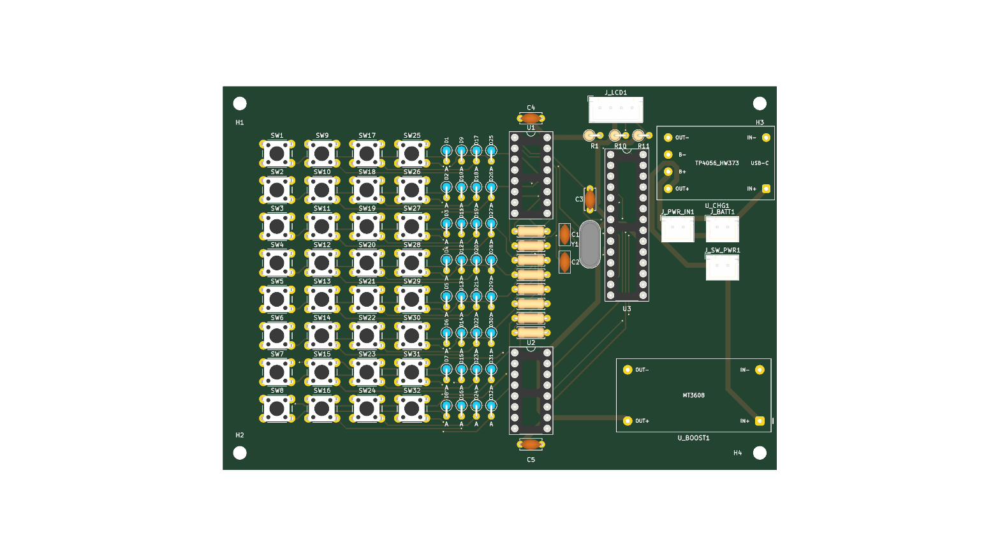
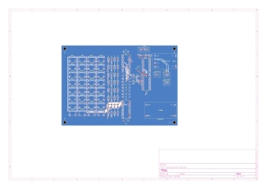

# KiCad Orchestrator — 100% AI-Generated Hardware Design & Verification Suite


> [!IMPORTANT]
> **🇺🇦 Повністю згенерований ШІ-інструмент / 🇬🇧 100% AI-Generated Tool**
>
> **Українською:** Весь цей репозиторій — **14-інструментний MCP-сервер для KiCad 10**, **5-агентний оркестратор-плагін (`v0.5.0`)** (разом із Design QA Gate та Gemini API делегатором) та **приклад проєкту друкованої плати калькулятора (`examples/calculator/`)** — є **повністю згенерованим ШІ інструментом (100% AI-Generated Hardware Design & Verification Suite)**. Перед виготовленням серійних плат обов'язково переглядайте Gerber, drill-файли та DRC-звіти.
>
> **English:** This entire repository — the **14-tool KiCad 10 MCP server**, the **5-agent orchestrator plugin (`v0.5.0`)**, and the **Calculator PCB reference project (`examples/calculator/`)** — is a **100% AI-Generated Tool**. Always review exported Gerbers, drill maps, and DRC reports prior to mass fabrication.

---

## Showcase: Calculator Reference Project (`examples/calculator/`)

The flagship hardware project in [`./examples/calculator/`](./examples/calculator/) is a complete KiCad 10 rechargeable desktop calculator board featuring:

- **MCU & Core:** `ATmega328P-AU` + `16 MHz` (`HC-49S`) crystal oscillator with `22 pF` load capacitors and `100 nF` decoupling
- **Display Mezzanine:** `LCD1602 I2C` interface (`J_LCD1` `JST-XH` / header architecture with mechanical & Z-clearance audit)
- **User Input:** `32-key 4x8` tactile switch matrix (`SW1..SW32`, `6x6 mm`) with `1N4148` anti-ghosting diodes (`D1..D32`)
- **Power & Charging:** `HW-373 TP4056` Li-ion USB Type-C charger (`U_CHG1`, `2.0 mm` edge overhang) + `MT3608` boost converter (`U_BOOST1`) + `J_BATT1` / `J_PWR_IN1` / `J_SW_PWR1` `JST-XH` connectors
- **PCB Stackup & Routing:** `130 x 90 mm` 2-layer `FR-4` (`1.6 mm`), explicit `GND` tracks + `B.Cu` ground zone pour (`Доріжки + Зона`), and `M3` (`H1..H4`) corner mounting holes

### 3D Top Render & 2D Copper/Zone Preview

| 3D Top View (`calculator_top.png`) | Multi-Layer SVG Preview (`calculator_preview.svg`) |
| :---: | :---: |
|  |  |

Full automated verification output for the Calculator board is saved in [`./examples/calculator/output/audit_report.json`](./examples/calculator/output/audit_report.json).

---

## Repository Structure

```text
kicad-orchestrator/
├── mcp_server/                 # FastMCP server + S-expression PCB inspector + editor + generators
│   ├── server.py               # 18 consolidated FastMCP tools + compact schema sync helper
│   ├── run_tool.py             # Direct CLI dispatcher, `--sync-schemas`, and `--save-state-summary`
│   ├── api_delegate.py         # Gemini Interactions & Antigravity SDK delegator (`gemini-3.5-flash-lite` .. `gemini-4-carbon`)
│   ├── cli_wrapper.py          # KiCad 10 `kicad-cli.exe` wrapper with isolated config & lock-safe staging
│   ├── pcb_inspector.py        # Balanced-paren S-expr parser, compact audit mode, IPC-2221, mezzanine & QA gate
│   ├── pcb_editor.py           # Safe S-expr layout editor, trace/via mutator & 2-layer A* autorouter
│   ├── requirements.txt        # Python dependencies (`mcp`, `pydantic`, `google-genai`, `google-antigravity`)
│   ├── generators/             # BOM parser & KiCad 10 footprint/symbol generators
│   │   ├── __init__.py
│   │   ├── bom_parser.py
│   │   ├── footprint_gen.py
│   │   ├── symbol_gen.py
│   │   └── templates.py
│   └── schemas/                # 14 exported compact JSON tool schemas (`parameters.type == "object"`)
├── plugin/                     # Antigravity plugin bundle (`v0.5.0`)
│   ├── plugin.json
│   ├── mcp_config.json
│   ├── assets/logo.svg
│   └── skills/
│       ├── kicad-orchestrator/SKILL.md
│       ├── kicad-searcher/SKILL.md
│       ├── kicad-generator/SKILL.md
│       ├── kicad-tracer/SKILL.md
│       └── kicad-tester-converter/SKILL.md
├── examples/calculator/        # Complete Calculator KiCad 10 project + `Items.DOCX` + exports
├── LICENSE                     # MIT License (Copyright 2026 berjer1e)
└── README.md
```

---

## Architecture: 14 Consolidated MCP Tools (`v0.5.0`)

All 18 consolidated tools are exposed via FastMCP (`mcp_server/server.py`) with compact 1-sentence schema descriptions (`mcp_server/schemas/*.json`), compact/failures-first inspection defaults (`inspect_pcb_layout(compact=True)`), one-shot disk caching (`run_tool.py --save-state-summary`), electrical netlist preparation (`create_netlist_from_bom`, `apply_netlist_to_pcb`, `add_nets_to_pcb`, `assign_pad_nets`), and Gemini SDK subtask delegation (`mcp_server/api_delegate.py`).

### 0. Safe S-Expression PCB Editing & 2-Layer A* Autorouting (`pcb_editor.py`)
| Tool | Key Parameters | Purpose |
| :--- | :--- | :--- |
| `edit_pcb_layout` | `pcb_path`, `board_outline=None`, `footprint_placements=None`, `zones=None`, `output_path=None` | Safely updates `Edge.Cuts` (rectangular or rounded corners), moves/rotates footprints by reference designator, and creates copper `(zone ...)` blocks without `pcbnew` SWIG/wxWidgets assertions. |
| `edit_pcb_traces` | `pcb_path`, `add_segments=None`, `add_vias=None`, `clear_nets=None`, `clear_bbox=None`, `output_path=None` | Adds or clears copper `(segment ...)` and `(via ...)` items with validated integer net IDs (resolving human net names automatically so `kicad-cli` never hangs on string net names). |
| `autoroute_pcb_nets` | `pcb_path`, `nets=None`, `grid_step_mm=0.5`, `trace_width_mm=0.3`, `clearance_mm=0.25`, `allow_vias=True`, `output_path=None` | Built-in obstacle-aware 2-layer 45°/orthogonal A* grid router directly over `.kicad_pcb` S-expressions for unrouted nets. |

### 1. S-Expression PCB Inspection & IPC-2221 Audit
| Tool | Key Parameters | Purpose |
| :--- | :--- | :--- |
| `inspect_pcb_layout` | `pcb_path` | Parses `Edge.Cuts` bounds, `board_stackup`, `silkscreen_audit` (font sizes, pad overlaps, connector pin labels), footprint bboxes, `estimated_height_mm`, track/via/zone stats, and lock status. |
| `find_unrouted_pads` | `pcb_path`, `net_filter=None`, `tolerance_mm=0.05` | Detects pads on multi-pad nets missing explicit copper `segment` tracks, separating `zone_only_pads` (e.g. `GND` relying only on zone pours) from `completely_unrouted_pads`. |
| `analyze_pcb_traces` | `pcb_path`, `net_currents_a=None`, `copper_oz=1.0`, `max_temp_rise_c=10.0`, `max_voltage_drop_v=0.1`, `neckdown_max_length_mm=3.0` | Computes IPC-2221 minimum trace widths, classifies pad-entry neck-downs (`trunk_ok`, `valid_neckdown`, `undersized_segment`), calculates segment resistance & `ΔU = I·R`, and audits critical net lengths (crystal `<= 15 mm`, `100 nF` decoupling `<= 8 mm`, `I2C`). |
| `manage_design_decisions` | `project_dir`, `action="check"`, `decisions=None`, `bom_or_pcb_path=None` | Checks, loads, or saves `<project_dir>/design_decisions.json` across the 8 Step 1.5 Design QA Gate categories. |

### 2. Mezzanine & 3D Mechanical Fit
| Tool | Key Parameters | Purpose |
| :--- | :--- | :--- |
| `check_mechanical_fit` | `pcb_path`, `min_clearance_mm=0.5`, `connector_clearance_mm=2.0`, `standoff_keepout_dia_mm=6.5`, `standoff_height_mm=10.0`, `mezzanine_modules=None` | Runs Checks A–E: same-side courtyard collisions, edge overhangs, connector mating clearances (`>= 2.0 mm`), mounting hole & display notes, standoff/screw-head keepouts (`M2.5 >= 5.5 mm`, `M3 >= 6.5 mm`), 2D projection + 3D Z-clearance (`estimated_height_mm`), and rigid board-to-board header alignment. |

### 3. Lock-Safe Zone Refill & DRC / ERC
| Tool | Key Parameters | Purpose |
| :--- | :--- | :--- |
| `refill_pcb_zones` | `pcb_path`, `output_path=None`, `force_when_locked=False` | Refills copper zones via `kicad-cli` in-place, or stages to `output_path` / `<stem>_refilled.kicad_pcb` when locked. |
| `run_validations` | `target_path=""`, `validation_type="drc"`, `output_path=None`, `schematic_parity=True`, `refill_zones=True`, `save_board=False` | Consolidated validation entrypoint (`drc` with `--schematic-parity`, `erc`, `footprint`/`symbol` SVG check, `locks` check, or `version`). |

### 4. Module Footprint/Symbol Generators & BOM Parser
| Tool | Key Parameters | Purpose |
| :--- | :--- | :--- |
| `parse_bom` | `source` | Parses Ukrainian/English BOM specs (`.txt`, `.csv`, or prose extracted from `.docx` such as `Items.DOCX`) into components, `board_properties`, `connector_details` (orientation, mounting, pitch, keying, current rating), pinouts, and rules. |
| `list_modules` | *(none)* | Lists built-in parametric module templates (`Mini360`, `Mini560`, `MT3608`, `TP4056_HW373`) and supported overrides. |
| `generate_module` | `module_name`, `output_dir`, `kind="both"`, `overrides=None` | Generates KiCad 10 `.kicad_mod` (`version 20260206`) footprints and/or `.kicad_sym` (`version 20251024`) symbols with keepouts and 100-mil pins. |

### 5. Manufacturing Exports & Environment
| Tool | Key Parameters | Purpose |
| :--- | :--- | :--- |
| `export_project` | `target_path`, `output_path`, `export_type="pcb_svg"`, `layers=None`, `width=1600`, `height=900`, `side="top"`, `quality="basic"`, `refill_zones=True` | Consolidated export tool supporting `gerbers`, `drill`, `step`, `sch_pdf`, `pcb_svg`, and `3d` PNG/JPEG renders (auto-stages zone refill if locked). |

---

## Architecture: 5 Autonomous Agent Skills & Step 1.5 Design QA Gate

The [`plugin/`](./plugin/) bundle (`v0.3.0`) coordinates five specialized agents:

1. **`kicad-orchestrator`** — Master coordinator executing the 6-stage pipeline:
   - **Step 1 (Ingest & Pre-Flight):** Runs `parse_bom` (`board_properties`, `connector_details`), `run_validations(..., validation_type="locks")`, and caches compact PCB state (`--save-state-summary`) to `output/state_summary.json`.
   - **Step 1.5 (Design QA Gate):** Calls `manage_design_decisions(project_dir, action="check")` and interactively resolves any ambiguities with the user via `ask_question` / `/grill-me`, persisting answers into `<project_dir>/design_decisions.json` across **8 mandatory categories**:
     1. `display_mounting_mode` (`panel_cable` vs `pcb_mezzanine`)
     2. `module_variants` (e.g. `Mini560` SMD `15x18` vs THT `29x18`)
     3. `connector_orientation_and_keying` (`vertical` vs `right_angle`, `keyed` vs unkeyed)
     4. `button_interface` (on-board `6x6` tactile switches vs external panel buttons)
     5. `pcb_stackup_and_limits` (`layer_count`, `copper_oz` `1.0`/`2.0`, `board_thickness_mm`)
     6. `board_shape_and_mounting` (`M2.5`/`M3` holes, `5.5`/`6.5 mm` standoff keepouts, `R3` corners)
     7. `silkscreen_conventions` (functional designators like `U_CHG1`, pin/polarity labels)
     8. `enclosure_fit_and_overhangs` (USB Type-C overhang, max component Z-height)
   - **Step 2 (Discovery & Generation):** Dispatches `searcher` and `generator`.
   - **Step 3 (Routing & Mechanical Audit):** Dispatches `tracer`.
   - **Step 4 (Verification & Export):** Dispatches `tester-converter`.
   - **Step 5 (Final Report):** Summarizes verified artifacts, metrics, and warnings.
2. **`kicad-searcher`** — Verifies KiCad 10 standard library mappings, module dimensions, connector orientation/mounting/pitch/keying, 3D Z-heights (`estimated_height_mm`), and mezzanine `(dx, dy)` hole-to-header offsets.
3. **`kicad-generator`** — Loads `design_decisions.json`, consumes `board_properties` & `connector_details`, and builds `.kicad_mod`/`.kicad_sym` files with standoff keepouts, keyed pin-1 markers, and `>= 1.0 x 0.15 mm` silkscreen labels.
4. **`kicad-tracer`** — Enforces IPC-2221 trace widths with pad-aware neck-down (`<= 3.0 mm`) & `ΔU = I·R <= 0.1 V`, explicit `GND` tracks + copper zone ("Доріжки + Зона"), silkscreen polarity traceability, and the 3 stacked/mezzanine checks.
5. **`kicad-tester-converter`** — Runs the full verification and export suite (`run_validations` for `locks`/`erc`/`drc`, `inspect_pcb_layout`, `analyze_pcb_traces`, `find_unrouted_pads`, `check_mechanical_fit`, `refill_pcb_zones`, and `export_project` for Gerber/Drill/STEP/SVG/PDF/3D outputs).

---

## Quick Start (Windows / KiCad 10)

### 1. Prerequisites
- **KiCad 10.0+** installed (the `kicad-cli` executable available on your PATH)
- **Python 3.11+**

### 2. Set Up the MCP Server Virtual Environment
```powershell
git clone https://github.com/berjer1e/kicad-orchestrator.git
cd kicad-orchestrator\mcp_server

python -m venv .venv
.\.venv\Scripts\Activate.ps1
pip install -r requirements.txt
```

### 3. Configure & Install the Antigravity Plugin
1. Update `plugin\mcp_config.json` paths (`command`, `args`, `KICAD_MCP_ROOT`, `KICAD_MCP_PYTHON`, and `KICAD_CLI_PATH`) to match your cloned `kicad-orchestrator\mcp_server\` directory.
2. Copy `plugin\` to `%USERPROFILE%\.gemini\config\plugins\kicad-orchestrator\`.
3. Sync the 22 JSON tool schemas:
```powershell
.\.venv\Scripts\python.exe run_tool.py --sync-schemas
```

### 4. Run Any Tool Directly via CLI (`run_tool.py`)
```powershell
# Check KiCad CLI version & GUI locks
.\.venv\Scripts\python.exe run_tool.py run_validations --args '{\"target_path\": \"..\\examples\\calculator\\Calculator.kicad_pcb\", \"validation_type\": \"version\"}'

# Cache compact PCB layout/trace/unrouted/fit state to disk once for zero-MCP agents
.\.venv\Scripts\python.exe run_tool.py --save-state-summary ..\examples\calculator\Calculator.kicad_pcb ..\examples\calculator\output\state_summary.json

# Run compact inspection, IPC-2221 trace analysis, schematic-parity DRC & SVG export
.\.venv\Scripts\python.exe run_tool.py inspect_pcb_layout --args '{\"pcb_path\": \"..\\examples\\calculator\\Calculator.kicad_pcb\"}'
.\.venv\Scripts\python.exe run_tool.py analyze_pcb_traces --args '{\"pcb_path\": \"..\\examples\\calculator\\Calculator.kicad_pcb\"}'
.\.venv\Scripts\python.exe run_tool.py run_validations --args '{\"target_path\": \"..\\examples\\calculator\\Calculator.kicad_pcb\", \"validation_type\": \"drc\", \"schematic_parity\": true}'

# Delegate lightweight BOM/spec reasoning via Gemini Interactions API
.\.venv\Scripts\python.exe api_delegate.py --list-models
```

---

## License

Released under the [MIT License](./LICENSE) — Copyright (c) 2026 `berjer1e`.
